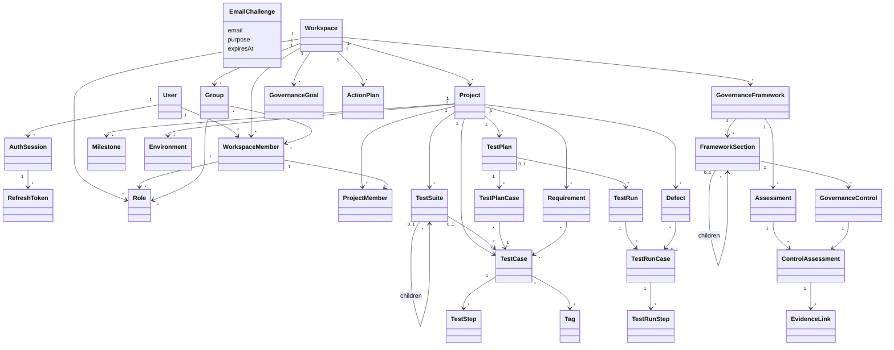

# Domain Model

Estado em 02/10/2026: identidade e administração de Workspace implementadas.
Projetos, participantes, marcos e ambientes também implementados na Fase 02;
[decisões de escopo e acesso](PROJECT_IMPLEMENTATION_DECISIONS.md).
Casos de Teste foram implementados na Fase 03;
[decisões e invariantes](TEST_MANAGEMENT_IMPLEMENTATION_DECISIONS.md).
Planos e Execuções foram implementados na Fase 04;
[decisões de snapshots e resultados](EXECUTION_IMPLEMENTATION_DECISIONS.md).
Defeitos implementados na Fase 05; [decisões e origem](DEFECT_IMPLEMENTATION_DECISIONS.md).
Owner é `Workspace.ownerMemberId`, separado de Role; Administrator/Member
são roles de sistema. Campos personalizados, tags e anexos são catálogos e
biblioteca do tenant. A árvore abaixo inclui módulos futuros; consulte as
[decisões da Fase 01](WORKSPACE_IMPLEMENTATION_DECISIONS.md) e
[guias disponíveis](../front-specs/README.md) para distinguir a entrega.

## Mapa mental do projeto

Este é o mapa de referência do Lambda Quality, consolidado em 30/09/2026.
Workspace é a fronteira de isolamento. A árvore resume a organização
funcional; indicações de vínculo representam associações, não propriedade
exclusiva nem exclusão em cascata.

```text
Identidade global
 ├── User
 │    └── AuthSession
 │         └── RefreshToken
 └── EmailChallenge (código de cadastro ou redefinição de senha)

Workspace
 ├── WorkspaceMember
 │    ├── vínculo com User
 │    ├── Roles atribuídas ao membro
 │    └── participação em Groups
 │
 ├── Role
 │    └── Permissions concedidas
 ├── Group
 │    ├── WorkspaceMembers participantes
 │    └── Roles atribuídas ao grupo
 │
 ├── Project
 │    ├── ProjectMember
 │    │    └── vínculo com WorkspaceMember
 │    │
 │    ├── TestSuite (hierarquia recursiva)
 │    │    └── TestCase (associação opcional à suíte)
 │    │         └── TestStep
 │    │
 │    ├── Requirement
 │    │      ↕ RequirementTestCase (muitos para muitos)
 │    │   TestCase
 │    │
 │    ├── TestPlan
 │    │    └── TestPlanCase
 │    │         └── referência ao TestCase selecionado
 │    │
 │    ├── TestRun (com ou sem TestPlan)
 │    │    └── TestRunCase (snapshot do caso)
 │    │         └── TestRunStep (snapshot do passo)
 │    │
 │    ├── Defect
 │    │    ├── vínculo opcional com TestRunCase
 │    │    └── referência opcional a sistema externo
 │    ├── Milestone
 │    └── Environment
 │
 └── Governance (área funcional do Workspace)
      ├── GovernanceFramework
      │    └── FrameworkSection (hierarquia recursiva)
      │         └── GovernanceControl (definição do controle)
      │
      ├── Assessment (avaliação de um GovernanceFramework)
      │    └── ControlAssessment (avalia um GovernanceControl)
      │         └── EvidenceLink (evidência dessa avaliação)
      │
      ├── GovernanceGoal (pode ter escopo de Project)
      └── ActionPlan
           ├── vínculo opcional com ControlAssessment
           └── vínculo opcional com GovernanceGoal
```

### Como interpretar os relacionamentos

- **Identidade e vínculo:** User é global e pode participar de vários
  Workspaces por WorkspaceMember. ProjectMember referencia esse vínculo,
  preservando a fronteira do Workspace.
- **Roles e grupos:** Role e Group pertencem ao Workspace e podem ser
  associados a vários membros. Roles podem ser atribuídas diretamente ao
  membro ou por grupo. Permission é um catálogo global; as concessões são
  feitas pelas Roles de cada Workspace.
- **Organização dos testes:** TestCase pertence ao Project e pode ficar
  sem TestSuite. Suite e FrameworkSection aceitam níveis recursivos.
- **Rastreabilidade:** Requirement e TestCase se relacionam muitos para
  muitos por RequirementTestCase, sempre dentro do mesmo Project/Workspace.
- **Planejamento e execução:** TestPlanCase seleciona um TestCase;
  TestRunCase/TestRunStep guardam snapshots históricos. Uma execução pode
  nascer de um plano ou ser avulsa; alterar o teste original não muda o Run.
- **Definição e avaliação:** GovernanceControl define o que será avaliado.
  Assessment representa uma avaliação de um framework em determinado
  momento. ControlAssessment registra o resultado de um controle nessa
  avaliação; um controle pode ter resultados diferentes em avaliações
  distintas. EvidenceLink pertence ao ControlAssessment, identificando a
  evidência do resultado avaliado.
- **Escopo da governança:** Governance é o agrupamento funcional dessas
  entidades no Workspace. Frameworks, avaliações, metas e planos de ação
  continuam tenant-scoped; uma meta pode ser vinculada a um Project.

### Recursos de apoio

O mapa destaca os relacionamentos principais e não substitui o catálogo
de [entidades](ENTITIES.md). Invitation apoia a entrada de membros; Tag
classifica testes; Attachment/AttachmentLink permitem anexos e vínculos;
AuditEvent registra ações relevantes. Uma evidência pode apontar para um
arquivo, recurso interno ou URL, conforme seu tipo. Integrações publicam
resultados de execução e conectam sistemas externos.

## Diagrama de relacionamentos



## Agregados

AuthSession (família de refresh tokens); Workspace; Project; TestCase; TestPlan; TestRun; GovernanceFramework;
Assessment.

User e AuthSession são globais; Workspace é a fronteira tenant. A sessão
não concede acesso a nenhum Workspace sem membership e autorização atuais.

## Invariantes

1.  Todo recurso tenant-scoped pertence a um Workspace.
2.  Relações de Project respeitam Workspace e Project.
3.  Suite não pode ser movida para si/descendente.
4.  `TestCase.sequence` é imutável.
5.  Step possui posição única no TestCase.
6.  TestRunCase/TestRunStep guardam snapshots.
7.  Alterar TestCase não altera Runs históricos.
8.  GovernanceControl é definição; ControlAssessment é estado temporal.
9.  NOT_APPLICABLE exige justificativa.
10. Assessment fechado não é silenciosamente reescrito.
11. Refresh token só é consumido uma vez; rotação é transacional.
12. Reuso de refresh token consumido revoga sua sessão/família.
13. Sessão revogada/expirada ou User suspenso não autentica recursos.
14. Relações tenant-scoped são validadas na aplicação e por constraints
    compostas quando o destino puder ser representado por FK.
15. User é criado somente após código de cadastro válido e uso único.
16. Código de redefinição não confirma cadastro e vice-versa.
17. Redefinir senha revoga todas as sessões do User atomicamente.

## Governança entregue na Fase 06

Framework define árvore/controles; Assessment e ControlAssessment copiam definições
e pesos na criação e preservam resultados/evidências ao fechar. Metas usam Strategies
públicas para métricas disponíveis; ações evoluem independentemente de avaliações
fechadas. Consulta de metas/ações de Projeto preserva acesso atual e contagens
filtradas; cálculo de Workspace exige todas as fontes. O índice é interno, sem
certificação oficial. Ver [decisões](GOVERNANCE_IMPLEMENTATION_DECISIONS.md).

## Associação e projeções adicionais — 04/10/2026

Defect pode referenciar Environment do mesmo Workspace/projeto, preservando snapshot de nome/categoria na associação. GovernanceGoal pode restringir GOVERNANCE_SCORE a uma FrameworkSection do mesmo framework/Workspace e atribuir responsável WorkspaceMember. Progresso consolidado é derivado dos snapshots de avaliação; não altera definições ou resultados ao consultar.

## Cofre e importação CSV — 06/10/2026

Project contém TestVaultEntry e recibos TestCaseImport. O cofre tem acesso atual
por projeto e revelação explícita auditada. Usuário, senha, URL e notas só existem
em ciphertext na persistência. Importação cria TestCase/TestStep sem Suite e
preserva BDD na descrição, sem criar planos. Controles usam creationOrder para
ordenar definições sem alterar snapshots históricos.
